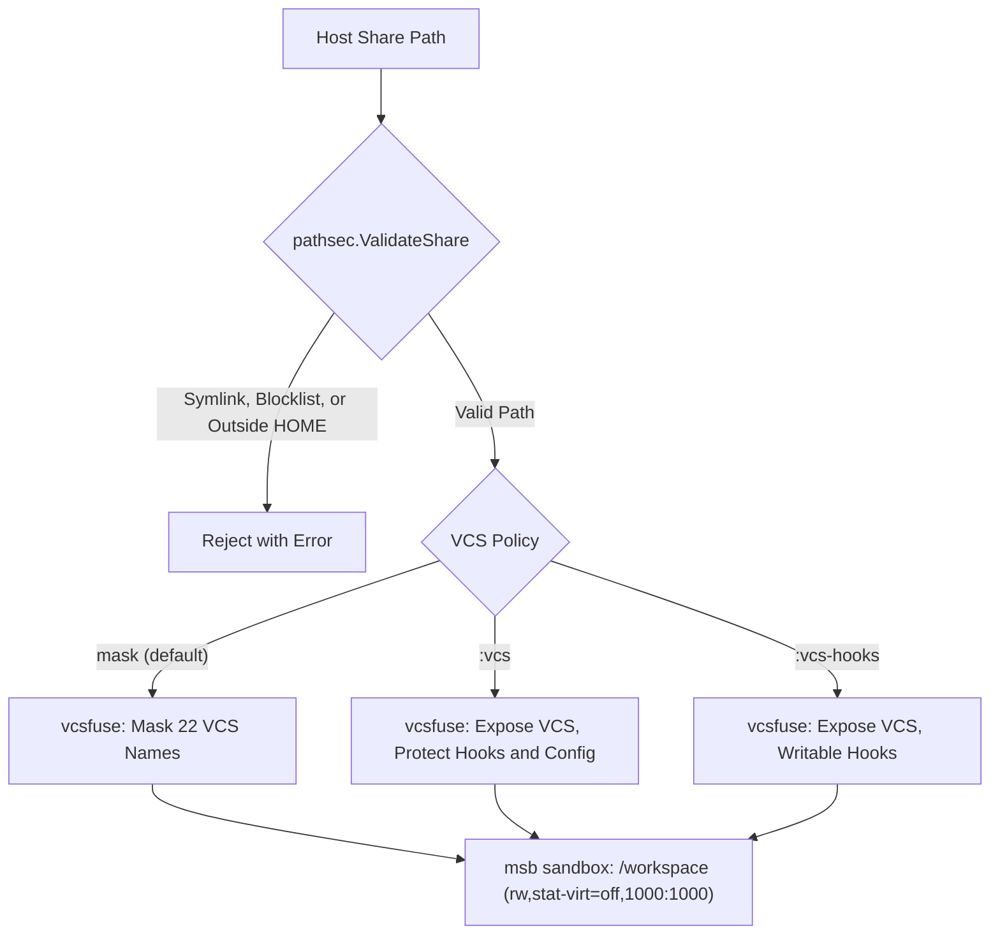

# AGENTS.md

This file defines the architecture, the Safe-by-Default security rules, the upstream `msb` contracts, the `test.sh` rules, the style rules, and the verification steps for `agbox`. Every change must keep these rules.

## 1. Project overview and architecture

`agbox` runs AI coding agents (`opencode` and `agy`) in isolated Linux microVMs. A microVM runs on `msb` (`libkrun` and `/dev/kvm`). This file calls one microVM a sandbox. One binary (`cmd/agbox`) serves both the user CLI and the embedded FUSE daemon (`agbox __filter ...`).

### Repository map

| Path | Responsibility |
|---|---|
| `cmd/agbox` | Entrypoint. Routes `__filter` to `vcsfuse` and all other commands to `cli.Main`. |
| `internal/complete` | Pure shell completion engine and bash completion script generator. |
| `internal/config` | Environment parsing, private state directories (`0700`, `0600`), snapshot numbers, and `run.meta` files. |
| `internal/pathsec` | Path canonicalization, `$HOME` containment, blocklists, share modifiers, alias checks, and disjointness checks. |
| `internal/vcsfuse` | Loopback FUSE filter and the `/workspace` Workspace Hub. It owns `openat2` confinement, VCS and hook protection, guest `1000:1000` ownership mapping, descriptor revocation, and the `ws.sock` control server. |
| `internal/mounttab` | `/proc/self/mountinfo` parsing, `/proc/<pid>/cmdline` checks before signals, and mount-verified directory cleanup. |
| `internal/msb` | `msb` argument builders, default-deny network rules, volume helpers, guest scripts, categories, and the `Runner` interface. |
| `internal/persist` | Credential capture, the agent cache, skills, rules, and `flock`-guarded profile volumes. |
| `internal/cli` | Argument parsers, mode dispatch, and orchestration. `cli.Main` is the only export. Files: `cli.go`, `parse.go`, `usage.go`, `base.go`, `run.go`, `lifecycle.go`, `persist_modes.go`, `share_mode.go`, `update_mode.go`, `completion_mode.go`. |
| `install.sh` | Idempotent prerequisite check, static build, and atomic install. |
| `AGBOX_ENV_RULES.md` | Default guest rules. `install.sh` and `agbox setup` install them into `$DATA_DIR/rules`. |
| `test.sh` | End-to-end verification harness. |
| `README.md` | Overview, quick start, and security summary. |
| `USER_GUIDE.md` | User workflows, categories, CLI reference, and environment variables. |
| `AGENTS.md` | Onboarding, security rules, `msb` contracts, `test.sh` rules, and the verification checklist. |

Write pure functions for parsing, validation, and command construction. Inject side effects through interfaces and function fields. For example, `msb.Runner`, `mounttab.Controller`, and the `StartFilter` and `StartHub` fields of the `cli` runtime. Tests then run without root and without `/dev/kvm`.

`persist_test.go` compares the headings of `AGBOX_ENV_RULES.md` with `defaultEnvRuleMarkdown` in `internal/persist/persist.go`. Edit both files together.

### Installed binary and source tree

- `./install.sh` builds `./cmd/agbox` with `CGO_ENABLED=0`. It stages the binary in the install directory and replaces the target with `mv -f`. It refuses a symlink or a directory at the target.
- The install directory is `~/.local/bin` (`/usr/local/bin` with `--allow-root`). `AGBOX_INSTALL_DIR` overrides it.
- A source edit does not change the installed binary until you run `./install.sh` again.
- `./test.sh` builds an isolated binary in `$TEST_ROOT/bin/agbox`. It leaves the installed binary unchanged.
- `./test.sh --disruptive` copies the installed binary to `ORIG_INSTALL_BIN` and runs `agbox remove --yes`. On exit, it runs `agbox remove --yes` again and restores the binary.

## 2. Safe-by-Default security rules

Every default must choose the most restrictive behavior. Each privilege increase needs an explicit CLI flag or a documented environment variable.

### Fail closed

- Stop on any failed validation, FUSE mount, socket bind, network rule, snapshot lookup, or secret transfer.
- Never fall back to weaker isolation. The only documented exception is `AGBOX_MASK_VCS=auto` (see the next section).
- Delete partial sandboxes, mounts, and state directories on failure.
- Exit silently with the child status only for direct interactive exits (`--cmd` and terminal UI). For every other failure, print `[agbox] ERROR: ...` with the captured `msb` diagnostics.

### Host execution and state

- Reject host `root` (`euid == 0`) unless you pass `--allow-root` or set `AGBOX_ALLOW_ROOT=1`.
- Create state directories with `config.EnsurePrivateDir`. It rejects symlinks and sets mode `0700`. Write metadata and secret files at mode `0600`.
- Redirect background FUSE daemon `stderr` to a private `.err` file (`ws.err` or `m*.err`, mode `0600`). Never inherit `os.Stdout` or `os.Stderr`. This stops `$(agbox run -d ... 2>&1)` from hanging.
- Before a signal, check that `/proc/<pid>/cmdline` matches `agbox __filter` and the target directory (`mounttab.IsFilterCmdline`).
- Before `os.RemoveAll` on a run directory, unmount the FUSE shares. Then check that zero mounts remain in `/proc/self/mountinfo` (`mounttab.TeardownFilterDir`).

### Shares, ownership mapping, and FUSE confinement



- Mount zero host paths and start zero FUSE daemons when `agbox run` gets no path and no `--share-hub`.
- Reject conflicting flags and modifiers with an error. Examples: `--ro` with `--rw`, `:ro,rw`, `:mask,vcs`, `:ro,vcs-hooks`, and `:vcs` on a single-file share. Never resolve a conflict silently.
- Run `pathsec.ValidateShare` on every share in `run`, `resume`, and `share add`:
  - Resolve symlinks. Reject missing paths, dangling symlinks, and control characters.
  - Require `$HOME` containment unless `AGBOX_ALLOW_OUTSIDE_HOME=1`.
  - Apply the blocklists for credentials, agent state, shell configs, `DATA_DIR`, `MSB_HOME`, VCS, and system paths. Include the parent directories of blocked paths.
  - Reject overlapping or nested host directories in one sandbox (`pathsec.CheckDisjointHostPaths`).
  - Require `st_nlink == 1` on writable single-file shares.
- Keep Workspace Hub shares inside `vcsfuse`. Use `openat2` with `RESOLVE_BENEATH` and `RESOLVE_NO_SYMLINKS`, `nosuid,nodev`, stripped `setuid` and `setgid` bits, blocked `ioctl`, and restricted `user.*` extended attributes.
- The default VCS policy is `mask`. It hides and write-protects 22 names case-insensitively:
  - Git: `.git`, `.gitignore`, `.gitattributes`, `.gitmodules`, `.mailmap`
  - Jujutsu and Sapling: `.jj`, `.sl`
  - Subversion: `.svn`
  - Mercurial: `.hg`, `.hgignore`, `.hgsub`, `.hgsubstate`, `.hgtags`, `.hgeol`
  - Bazaar, Darcs, Pijul: `.bzr`, `.bzrignore`, `_darcs`, `.pijul`
  - Fossil: `.fossil-settings`, `.fslckout`, `_fossil_`
  - CVS: `.cvsignore`
- The `:vcs` policy (`VCSAllow`) exposes VCS metadata. It returns `EPERM` for writes to these paths:
  - Hooks: `.git/hooks`, `.git/**/hooks`, `.jj/**/hooks`, `.svn/**/hooks`, `.pijul/**/hooks`, and `_darcs/**/prefs`.
  - Git config files: `.git/config`, `.git/config.worktree`, `.git/commondir`, `.git/gitdir`, `.git/modules/**/config`, `.git/worktrees/**/config`, and `.git/worktrees/**/config.worktree`.
  - Submodules or worktrees named `refs`, `logs`, or `objects` keep the same Git config protection.
  - Other executable config files: `.jj/**/config.toml`, `.jj/**/config`, `.sl/config`, `.sl/hgrc*`, `.bzr/**/branch.conf`, `.bzr/**/locations.conf`, and `.hg/hgrc*`.
  - Entries named `.git`, `.jj`, `.hg`, `.svn`, `_darcs`, `.pijul`, `.fossil-settings`, `_fossil_`, `.bzr`, or `.sl`. Create, `mkdir`, link, delete, and rename fail.
- `Rename` rejects `RENAME_WHITEOUT` and unknown flags. It walks the moved subtree through pinned `openat2` descriptors. It checks symlink targets again at the new depth, in both directions of `RENAME_EXCHANGE`.
- `Link` rejects hardlinks that cross a VCS or hook boundary with `EPERM`.
- `Rename` rejects multi-link regular files (`st_nlink != 1`) that cross a VCS or hook boundary with `EPERM`.
- `Link` and `Rename` promote open file and directory handles on valid same-boundary links and single-link moves. Policy downgrades then count and revoke those handles.
- The `:vcs-hooks` policy (`--vcs-hooks`) makes hooks writable. It needs a writable share.
- `vcsfuse` maps host ownership to the guest `agent` (`1000:1000`) in memory. `/workspace` mounts with `:rw,stat-virt=off`. This causes no `user.msb.*` xattr probes and no xattr writes on host files.
- `AGBOX_MASK_VCS=off` (`--no-mask`) mounts shares directly without FUSE:
  - Read-only shares use `:ro,stat-virt=relaxed,uid=1000,gid=1000`.
  - Writable shares use `:rw,stat-virt=off` when the host UID and GID are `1000:1000` or the filesystem has no `user.*` xattr support.
  - Other writable shares use `:rw,stat-virt=relaxed,host-perms=mirror,uid=1000,gid=1000`.
- `AGBOX_MASK_VCS=strict` is the default. It never falls back to a direct mount. `AGBOX_MASK_VCS=auto` falls back to a direct mount with a warning in three cases. The cases are an unsupported `DATA_DIR`, a missing hub starter, and a failed hub start. `--share-hub` never falls back. `DATA_DIR` must not contain whitespace or backslashes when masking is on.
- `agbox share add` defaults to read-only with masked VCS. Only `--rw` or `:rw` makes a share writable. `--vcs` changes only the VCS policy.
- Bind `$DATA_DIR/run/<id>/ws.sock` at mode `0600` in a `0700` directory. Check the peer UID with `SO_PEERCRED` on every connection.
- `agbox share rm` and `agbox share set --ro` fail when open writable handles exist, unless you pass `--force`. Revoke open descriptors at once. Return `ESTALE` on detach, `EROFS` on a read-only downgrade, and a masked result on a VCS downgrade. Flush the guest VFS lookup caches.

### Networking, secrets, caches, and profile disks

- `--net public` is the default. It uses `--net-default deny`. Order the rules like this:
  1. `allow@dns`
  1. `deny@host` rules
  1. All deny groups and CIDRs
  1. `allow@public`
- The deny groups are `loopback`, `private`, `link-local`, `multicast`, and `meta`. The deny CIDRs are `0.0.0.0/8`, `100.64.0.0/10`, `100.100.100.200/32`, `168.63.129.16/32`, `169.254.0.0/16`, `240.0.0.0/4`, `[::/128]`, `[::ffff:0:0/96]`, `[64:ff9b::/96]`, `[fe80::/10]`, and `[fd00:ec2::254/128]`. Wrap IPv6 CIDRs in brackets.
- Bind `--serve` host forwarding to `127.0.0.1` only. Pair each published guest port with `--net-rule allow:ingress@loopback:<proto>:<guestPort>`. Skip that rule under `--no-net`.
- The `--serve` readiness probe never follows redirects.
- Use `--proto '=https' --proto-redir '=https' --tlsv1.2` on every `curl` download.
- Never pass API keys or tokens in CLI arguments. Never bake them into snapshots. Stream them over `stdin` into `0600` guest files.
- `pushKeys` checks that `/home/agent` is not a symlink. It deletes `/home/agent/.agbox-keys.sh` before it writes. It sets mode `0600` after the write. `agbox auth` never prints captured stdout in errors.
- Run `agbox auth` and `agbox update` in disposable zero-share sandboxes. `agbox update` passes zero API keys and zero saved credentials. It checks ELF magic (`\x7fELF`), size bounds, `st_nlink == 1`, and SHA-256 digests in `manifest.json`. An exclusive `flock` on `$DATA_DIR/.agents.lock` guards updates.
- Mount `$DATA_DIR/skills`, `$DATA_DIR/rules`, and `$DATA_DIR/agents` read-only with `:ro,stat-virt=relaxed,uid=1000,gid=1000`. Reject symlinks with `Lstat`. Bind-mount them read-only (`ro,bind`) in the guest.
- `install.sh` and `agbox setup` install `AGBOX_ENV_RULES.md` into `$DATA_DIR/rules`. The runner stages it and bind-mounts it onto the guest `AGENTS.md` paths. The file says that the `/workspace` root rejects file creation with `EROFS`.
- Pass `-u root` or `-u agent` to every `msb exec`. `msb snap restore -u agent` sets the default `msb exec` user to `agent`. Pass `-u root` for guest setup and cache flushes.
- Guard each `--profile` `ext4` volume with an exclusive host `flock` on `$DATA_DIR/profiles/.<name>.lock`. The lock file stays outside the profile directory. Refresh `msb ls` after you take the lock. Hold the lock during `profile rm`. Find the `disk.raw` file with `msb.ResolveVolumeDiskPath`. Attach it with `--mount-disk <disk.raw>:/home/agent/.agbox-profile:rw,format=raw,fstype=ext4`.
- A profile name has 48 characters or fewer. A run name has 63 characters or fewer. `agbox` reserves the names `base` and `run-<digits>`.

### Base image defaults

- `create-base` installs `shellcheck` and `mdformat` in every snapshot. It also installs `git`, `ripgrep`, `curl`, `less`, `procps`, and `sudo`.
- `create-base` writes agent settings only when the file does not exist. It never overwrites a user file on `edit-base` or `--profile`:
  - `agy` (`/home/agent/.gemini/antigravity-cli/settings.json`): `"toolPermission": "always-proceed"`, `"queuedMessages": "send-immediately"`, `"allowNonWorkspaceAccess": true`, and `"trustedWorkspaces": ["/workspace"]`.
  - `opencode` (`/home/agent/.config/opencode/opencode.json`): `"permission": "allow"`. The default for `general.followup` is `"steer"`.

## 3. Upstream `msb` contracts

Changes in `internal/msb`, `internal/cli`, or `internal/vcsfuse` must respect these `msb` behaviors:

- **Streaming and user.** A non-TTY `msb exec` hides child output unless you pass `--stream`. `--stream` fails unless you pipe stdin or pass `--no-stdin`. Always pass `-u root` or `-u agent`.
- **`stat-virt` modes.** `msb snap restore -v` defaults to `stat-virt=strict`. It probes mount roots with `setxattr` and fails with `EROFS` on `/workspace`. Mount `/workspace` with `:rw,stat-virt=off` and no `uid=` or `gid=`. Mount read-only caches with `:ro,stat-virt=relaxed,uid=1000,gid=1000`.
- **Disk volumes.** `msb snap restore -v` forces `VolumeKind::Directory`. It rejects `--kind disk` volumes such as `agbox-profile-<name>`. Attach profile disks with `--mount-disk <disk.raw>:<guest>:rw,format=raw,fstype=ext4`.
- **Guest flush.** Run `msb stop -t 10` before `msb rm -f` (`destroySandbox`) when a sandbox has a profile disk. This flushes guest pages and the journal to `disk.raw`. `agbox stop` writes a `deleting` marker in `$DATA_DIR/run/<id>`. Other sessions then skip the duplicate teardown. `destroySandbox` treats `sandbox not found` as success.
- **Snapshots.** `msb snap rm` refuses to delete the current head while other members exist in the snapshot group. It also refuses to delete a parent with child snapshots unless you pass `--force`. `msb snap reindex` never prunes missing rows from SQLite. `agbox remove` deletes `agbox:v*` snapshots newest-first with `--force`. On a current-head error, it switches the head with `msb snap head <member>` and retries. It deletes `$MSB_HOME/snapshots/agbox` only after `msb snap rm` succeeds for every `agbox:v*` snapshot and zero other members remain.
- **Firewall order.** Keep `--net-default deny`. Put `allow@dns` before `deny@host`. Put all deny groups and CIDRs before `allow@public`. Wrap IPv6 CIDRs in square brackets.
- **No nesting.** An agent inside an `agbox` sandbox has no `/dev/kvm`. A minimal container may also lack `fusermount`. Inside such a sandbox, run `./test.sh --skip-vm`. Use `sudo ./test.sh --allow-root --skip-vm` when direct FUSE mounts need root. Run the KVM checks on the host.

## 4. `test.sh` rules

Every `test.sh` edit and every new user-visible feature must follow these rules.

### Non-disruptive default

- Non-disruptive runs must not change host state. Host binaries, `AGBOX_DATA_DIR`, `MSB_HOME`, snapshots, profiles, and running sandboxes stay as they are.
- Check `99-verify-host-unchanged` records host fingerprints before the tests. It fails when a host binary, data directory, `MSB_HOME` file, sandbox, snapshot, or volume changes.
- `--disruptive` runs `99-verify-disruptive-cleanup` instead. It checks that `agbox remove --yes` deleted all live state.
- `test.sh` puts `TEST_ROOT` under `~/.cache/agbox-e2e-<id>`. This satisfies `$HOME` containment without weakening `AGBOX_ALLOW_OUTSIDE_HOME`. The harness deletes `~/.cache` on exit if it created that directory.
- `test.sh` prepares an isolated `RUNTIME_DATA_DIR` for sandbox checks. It copies existing `run/<id>` markers there. It adds `SUITE_ID` to temporary sandbox and profile names.

### Modes and options

| Flag | Coverage |
|---|---|
| none | Quick non-disruptive suite: `01` to `08`, `09` to `11`, `20` to `23`, and `99`. |
| `--full` (alias `--long`) | Adds `30` to `34` and the isolated lifecycle check `40`. |
| `--disruptive` | Clean-slate host suite. Backs up the installed binary. Runs `remove --yes`, `./install.sh`, `create-base`, and `edit-base` (`10` to `12`). Then runs `20` to `23` and `99`. |
| `--full --disruptive` | Runs both suites. Check `40` does not run, because `10` to `12` cover it. |
| `--skip-vm` | Runs `01` to `08` only. Needs no `/dev/kvm` and no `msb`. |
| `--filter <text>` | Runs checks whose ID or description contains `<text>`, plus required setup checks. |
| `--log-dir <dir>` | Writes logs to `<dir>`. The default is a new `mktemp` directory under `/tmp`. |
| `-v`, `--verbose` | Also streams check output to stdout. |
| `--allow-root` | Passes `--allow-root` to `./install.sh` and `agbox` when `euid == 0`. |

### Automation and diagnostics

- Run every check without prompts. Use `</dev/null`, `--yes`, and `with_timeout` on every external command. Wrap every direct `msb` call in `with_timeout`.
- `run_check` runs each check in an isolated subshell (`set -Eeuo pipefail`). A failure never blocks independent checks. The harness prints a final summary with log paths.
- `run_capture` writes expected-success output to a temporary file, not a `$(...)` pipe. This stops detached daemons from hanging the capture. It prints the output on failure. Put timeouts on `curl`. Dump background logs when startup times out.
- Register `trap global_cleanup EXIT INT TERM HUP`. `_run_with_timeout` tracks `ACTIVE_CHILD_PGID` so signals interrupt at once. On a signal, kill active process groups, unmount FUSE shares, delete temporary resources, and restore binary backups.
- Pass paths and sockets to `python3` helpers through `sys.argv`. Never interpolate them into code. Read lists with `while IFS= read -r`.

### Check layout

| Checks | Coverage |
|---|---|
| `01` | Static style: `bash -n`, `gofmt`, semicolons in Go comments, error strings, and Markdown prose, and `mdformat --check`. |
| `02` to `04` | `go vet`, `go test -race`, and binary builds. |
| `05` | `--help` output for all 15 modes, category listing, and flag rejection. |
| `06` | Offline security checks: share conflicts, `share set` and `share rm` errors, guest alias escapes, `--share-hub` with `--no-mask`, `run --name run-123`, hardlinked single files, `--net` conflicts, and tamper checks. |
| `07` | Fake-`msb` error checks. Each non-zero `msb` exit shows diagnostics for `stop`, `profile`, and `remove`. |
| `08` | Live Workspace Hub: VCS masking, `:ro`, single-file slots, `:vcs` config protection, rename escapes, hook downgrade, `rw` to `ro`, and `rm` with and without `force`. |
| `09` to `12` | KVM and `msb` preflight, then an isolated base bootstrap or the disruptive clean-slate steps. |
| `20` to `23` | Core sandbox checks: shares, secrets, global rules mounts, persistence, profiles, dynamic shares with `--rw --vcs-hooks` downgrade, suspend, resume, and `--serve --probe`. |
| `30` to `34`, `40` | Extended checks: firewall, descriptor revocation (including VCS descriptors on `share set --mask-vcs`), profile lock, password `--serve`, live `update`, and the isolated lifecycle. |
| `99` | Host state check (`verify-host-unchanged` or `verify-disruptive-cleanup`). |

## 5. Code and documentation style

- Write comments, help text, error messages, and Markdown in Simplified Technical English (ASD-STE100):
  - Use active voice and concrete verbs.
  - Write one instruction per sentence. Keep procedures to 20 words or fewer and descriptions to 25 words or fewer.
  - Keep noun clusters to three words or fewer.
  - Avoid marketing adjectives and vague words.
  - Use one term for one concept.
  - Do not use semicolons in comments, error strings, help text, or Markdown prose.
- Use only GitHub Flavored Markdown that `mdformat` keeps unchanged. Alerts, tables, Mermaid fences, and `<details>` blocks with blank lines inside are safe. Footnotes are not safe.
- Format Go files with `gofmt` and Markdown files with `mdformat`. Keep bash scripts clean under `bash -n` and `shellcheck`.

## 6. Verification checklist

Run these commands from `/workspace/agbox` before you finish a change:

```bash
gofmt -w ./cmd ./internal
mdformat README.md USER_GUIDE.md AGENTS.md AGBOX_ENV_RULES.md
bash -n install.sh test.sh
go vet ./...
go test -count=1 -race ./...
go build -o /dev/null ./cmd/agbox
./test.sh --skip-vm
```

In a container without `fusermount`, also run `sudo ./test.sh --allow-root --skip-vm`. On a host with KVM and `msb`, run `./test.sh`. Before a release, run `./test.sh --full --disruptive` and `./install.sh`.
