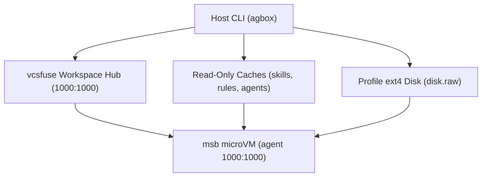

# agbox

`agbox` runs AI coding agents inside disposable Linux microVMs. It supports [OpenCode](https://opencode.ai) and [Google Antigravity CLI (`agy`)](https://antigravity.google). It uses [microsandbox (`msb`)](https://microsandbox.dev) to boot each microVM.



Each run boots a sandbox from a local base snapshot. A sandbox is one microVM. `agbox` mounts only the host paths that you pass on the command line. By default, `agbox` masks version-control entries through FUSE. It also blocks private, multicast, and cloud metadata ranges. If a check fails, `agbox` stops and deletes partial state.

The [User Guide](USER_GUIDE.md) describes workflows, package categories, share options, persistence, CLI flags, and environment variables. [AGENTS.md](AGENTS.md) describes the architecture and the rules for contributors.

## Quick Start

> [!NOTE]
> Host requirements: Linux with `/dev/kvm` (Debian or Ubuntu target), `glibc` 2.28 or newer, Go, and `fuse3`.

### 1. Install and check the host

Run the installer as your normal user. Pass `--allow-root` when you run it as `root`.

```bash
./install.sh
```

The installer runs these steps:

1. It checks `glibc` (2.28 or newer), `go`, and `fusermount3` (or `fusermount`).
1. It downloads the `msb` installer over HTTPS (TLS 1.2 or newer) if `msb` is missing.
1. It builds a static `agbox` binary and installs it atomically in `~/.local/bin` (`/usr/local/bin` for `root`).
1. It installs the default sandbox rules (`AGBOX_ENV_RULES.md`) into `~/.local/share/agbox/rules`.
1. It installs bash completion into `~/.local/share/bash-completion/completions/agbox` (`/usr/share/bash-completion/completions/agbox` for `root`). Pass `--skip-completion` to skip this step.
1. It runs `agbox setup`. This command checks `/dev/kvm`, FUSE mounts, `msb doctor`, and an offline Alpine microVM.

> [!TIP]
> Pass `--skip-setup` to install the binary on hosts without `/dev/kvm`, such as headless containers.

### 2. Create the base snapshot

Build the base snapshot with `opencode`, `antigravity` (`agy`), or `both`. Add developer toolchains with `--add`. The categories are `core`, `go`, `rust`, `esphome`, `embedded-rust`, `chrome`, `hugo`, `caddy`, and `all`.

```bash
agbox create-base --add core,go,rust,esphome both
```

Every snapshot includes `shellcheck`, `mdformat`, `git`, `ripgrep`, `curl`, `less`, `procps`, and `sudo`. `create-base` writes default agent settings for unattended work. It never overwrites a settings file that exists. Run `agbox edit-base --list` to print the categories.

### 3. Authenticate

Sign in once inside a zero-share sandbox, or export API keys in your host shell:

```bash
# Option A: saved OAuth credentials in $DATA_DIR/auth (mode 0600)
agbox auth antigravity
agbox auth opencode

# Option B: per-run API keys, streamed over stdin and never placed in CLI arguments
export ANTHROPIC_API_KEY="sk-ant-..."
export GEMINI_API_KEY="AIza..."
```

### 4. Add global skills and rules (optional)

Global skills and rules mount read-only in every sandbox:

```bash
agbox skills add ~/my-skills/code-review
agbox rules add ~/my-rules/engineering-standards.md
```

### 5. Run and manage sandboxes

> [!IMPORTANT]
> Place all options before the agent name and the shared paths.

```bash
# Run interactive OpenCode in a disposable sandbox
agbox run opencode ~/projects/myapp

# Mix read-only, writable, and VCS-enabled shares in one sandbox
agbox run antigravity ~/projects/docs:ro ~/projects/lib:rw ~/projects/app:rw,vcs

# Keep a named sandbox after exit, then continue the latest conversation
agbox run --persist --name myapp opencode ~/projects/myapp
agbox run --persist --name myapp -c opencode ~/projects/myapp

# Run one shell command in a disposable sandbox
agbox run --cmd "go test ./..." ~/projects/myapp

# Start the OpenCode web UI on 127.0.0.1:4096, or Antigravity Remote Control in the background
agbox run --name web --serve --port 4096 ~/projects/myapp
agbox run --name rc -d --remote-control ~/projects/myapp

# Inspect, suspend, resume, or delete sandboxes
agbox status
agbox suspend agbox-myapp
agbox resume agbox-myapp
agbox stop agbox-myapp
```

The [User Guide](USER_GUIDE.md) covers live shares (`agbox share`), systemd user services (`agbox service`), conversation profiles (`--profile`), agent updates (`agbox update`), and `edit-base`.

## Design

- **Hardware isolation.** Containers share the host kernel. `agbox` runs each sandbox on its own guest kernel (`/dev/kvm` and `libkrun`). Guest `root` commands stay inside the sandbox.
- **Safe-by-Default.** `agbox` masks VCS metadata and blocks local, private, multicast, and cloud metadata ranges. Each override needs an explicit flag or environment variable.
- **Fail closed.** If a check fails, `agbox` stops. It never falls back to weaker isolation. Two overrides can weaken isolation: `--no-mask` and `AGBOX_MASK_VCS=auto`.
- **Snapshots.** `agbox create-base` builds `agbox:v1`. `agbox edit-base` saves `agbox:v<N+1>`. `agbox run` restores a snapshot into `agbox-<name>` or `agbox-run-<pid>`. It deletes that sandbox on exit unless you pass `--persist`, detach, or suspend.
- **One binary.** The same binary runs the CLI and the FUSE filter (`agbox __filter`). The filter uses `go-fuse/v2` and Linux `openat2`.
- **Non-root guest.** The guest user is `agent` (`1000:1000`) with passwordless `sudo`. The FUSE Workspace Hub shows shared files as `1000:1000` (`stat-virt=off`). `agbox` mounts read-only caches with `uid=1000,gid=1000`.
- **Secrets on stdin.** `agbox` never stores API keys in a snapshot. It never puts secrets in CLI arguments, where `/proc/<pid>/cmdline` exposes them. It streams them over `stdin` into `/home/agent/.agbox-keys.sh` (mode `0600`).

### Network policy

`agbox create-base` and `agbox run` pass `--net public` to `msb`. This profile uses a default-deny firewall (`--net-default deny`). The rules apply in this order:

1. `allow@dns` lets the guest resolve names.
1. `deny@host` blocks the host gateway ports.
1. Deny groups block `loopback`, `private`, `link-local`, `multicast`, and `meta` addresses.
1. Explicit CIDR rules block these ranges:
   - `0.0.0.0/8`, `100.64.0.0/10` (CGNAT), and `240.0.0.0/4`
   - `169.254.0.0/16`, `100.100.100.200/32`, and `168.63.129.16/32`
   - `[::/128]`, `[::ffff:0:0/96]` (IPv4-mapped), and `[64:ff9b::/96]` (NAT64)
   - `[fe80::/10]` and `[fd00:ec2::254/128]`
1. `allow@public` permits outbound public traffic for model APIs and package mirrors.

With `--serve`, `agbox` also adds `--net-rule allow:ingress@loopback:tcp:3000` and forwards a host port bound to `127.0.0.1`.

> [!WARNING]
> `--net all` permits all outbound traffic.

### Share policy

`agbox` mounts no host path and starts no FUSE daemon unless you pass a path or `--share-hub`.

1. **Workspace Hub.** An embedded FUSE Workspace Hub mounts each share at `/workspace/<name>` with `nosuid,nodev`. All host access uses `openat2` with `RESOLVE_BENEATH` and `RESOLVE_NO_SYMLINKS`.
1. **VCS masking.** The default policy is `:mask`. It hides 22 VCS directory names and control files (`ENOENT`). It blocks writes to them at every depth (`EPERM`). Matching is case-insensitive.
1. **VCS hooks.** The `:vcs` policy exposes VCS metadata. It write-protects hooks and executable config files (`EPERM`). Writable hooks need `:vcs-hooks` on a writable share.
1. **Path checks.** `pathsec.ValidateShare` resolves symlinks and rejects missing paths, overlapping paths, and control characters. Paths outside `$HOME` fail unless you set `AGBOX_ALLOW_OUTSIDE_HOME=1`.
1. **Blocklist.** `agbox` rejects shares of VCS paths, credentials, agent state, shell configs, `DATA_DIR`, `MSB_HOME`, and system paths. It also rejects their parent directories, including `$HOME`.
1. **Single files.** A writable single-file share must be a regular file with `st_nlink == 1`.

> [!WARNING]
> `--no-mask` (`AGBOX_MASK_VCS=off`) mounts shares directly and exposes `.git` and its hooks to the guest.
>
> `AGBOX_MASK_VCS=auto` falls back to the same direct mount when the FUSE Workspace Hub cannot start. It prints a warning.

<details>
<summary>Security properties reference</summary>

| Property | Enforced by | Guarantee |
|---|---|---|
| Hardware isolation | `msb` (`/dev/kvm`, `libkrun`) | Each sandbox boots its own guest kernel. Guest `root` commands do not affect the host kernel. |
| Non-root host execution | `cli`, `install.sh` | Rejects `euid == 0` unless you pass `--allow-root` or set `AGBOX_ALLOW_ROOT=1`. |
| Private state directories | `config.EnsurePrivateDir` | Rejects symlinks, sets mode `0700` on directories, and writes files at mode `0600`. |
| Input validation | `config.FromLookup`, `cli`, `persist` | Rejects bad CPU, RAM, and disk sizes, conflicting share flags, control characters, unsafe IDs, bad `--net-rule` tokens, and non-HTTPS installer URLs. |
| Explicit shares | `cli`, `pathsec.ValidateShare` | Mounts no host path unless you pass it. Rejects overlapping trees. Limits shares to `$HOME` by default. |
| Blocklist | `pathsec.DefaultBlocklist` | Blocks SSH, cloud, agent, VCS, shell, `direnv`, `DATA_DIR`, `MSB_HOME`, and system paths. It also blocks parent directories and symlink targets. |
| Direct VCS shares | `pathsec.ContainsVCSComponent` | Rejects direct shares of any VCS directory, VCS subdirectory, or VCS control file. |
| Single-file shares | `pathsec.ValidateShare`, `vcsfuse` | Requires a regular file with `st_nlink == 1` on writable shares, opens, and attribute changes. |
| VCS masking | `vcsfuse` | Hides 22 VCS names (`ENOENT`) and blocks writes to them (`EPERM`) at every depth. |
| VCS write protection | `vcsfuse` (`:vcs`) | Blocks writes to hooks and executable config files such as `.git/config` and `.git/config.worktree` (`EPERM`). See AGENTS.md. |
| VCS admin entries | `vcsfuse` (`:vcs`) | Blocks create, `mkdir`, link, delete, and rename on 10 top-level admin names such as `.git` (`EPERM`). |
| Rename and link | `vcsfuse` | Rejects `RENAME_WHITEOUT`, cross-boundary hardlinks, and cross-boundary multi-link renames (`EPERM`). Walks moved subtrees, rechecks symlink depth, and promotes open handles. |
| Live share control | `vcsfuse`, `cli` | Restricts `ws.sock` to the host UID with `SO_PEERCRED`. Revokes open descriptors with `ESTALE` or `EROFS`. |
| Pinned root | `vcsfuse` | Resolves each operation with `RESOLVE_BENEATH` and `RESOLVE_NO_SYMLINKS`. Rejects detached inodes (`ENOENT`). |
| Symlink confinement | `vcsfuse` | Blocks absolute targets, targets that leave the share, and masked VCS targets (`EPERM`). |
| Special files | `vcsfuse` | Mounts with `nosuid,nodev`. Allows regular files only. Opens through `O_PATH` first. Blocks `ioctl`. |
| Privilege bits | `vcsfuse` | Strips `setuid` and `setgid` on creation. Rejects `setuid`, `setgid`, and cross-UID `chown` (`EPERM`). |
| Extended attributes | `vcsfuse` | Allows `user.<name>` only. Blocks `security.*`, `system.*`, and `trusted.*`. |
| Network policy | `msb.BuildRestoreArgs` | Orders `allow@dns`, deny rules, and `allow@public` as the Network policy section lists. |
| Loopback web server | `cli`, `msb` | Binds the host port to `127.0.0.1` only. |
| HTTPS downloads | `install.sh`, `cli`, `msb`, `persist` | Uses `--proto '=https' --proto-redir '=https' --tlsv1.2` on every `curl` download. |
| Secret streaming | `msb.FormatEnvExports`, `cli` | Streams API keys over `stdin` into `/home/agent/.agbox-keys.sh` (mode `0600`). Never uses CLI arguments. |
| Saved credentials | `persist`, `cli` | Saves allowlisted login files (under 64 KiB, no symlinks) at mode `0600`. Streams them over `stdin`. |
| Agent cache | `persist.InspectAgentsDir`, `cli` | Fetches updates in a zero-share, zero-secret sandbox. Checks ELF magic, size, `st_nlink == 1`, and SHA-256. Mounts read-only. |
| Global skills | `persist.InspectSkillsDir`, `cli` | Rejects symlinks and special files. Mounts read-only, then bind-mounts read-only in the guest. |
| Global rules | `persist.InspectRulesDir`, `cli` | Rejects symlinks, subdirectories, non-Markdown files, NUL bytes, and large files. Mounts read-only. |
| Profile disks | `persist.LockProfile`, `cli` | Locks each profile disk with a host `flock` in `profiles/.<name>.lock`. Refuses two writers. |
| PID reuse | `mounttab.IsFilterCmdline` | Checks `/proc/<pid>/cmdline` for `agbox __filter` and the target directory before sending a signal. |
| Safe deletion | `mounttab.TeardownFilterDir` | Checks for zero active mounts in `/proc/self/mountinfo` before `os.RemoveAll`. |
| Resume checks | `cli`, `install.sh` | Checks FUSE, KVM, and an offline sandbox during setup. Checks shares, caches, and profiles again on resume. |
| User services | `service`, `cli` | Saves mode `0600` specs. Requires a regular `--env-file` (mode `0600` or stricter, no symlinks). Keeps secrets out of `agbox@.service`. Stops the microVM before FUSE unmount (`KillMode=mixed`). |

</details>

## Package structure

```text
agbox/
├── cmd/agbox/         Entrypoint. Routes __filter to vcsfuse and other commands to cli.
├── internal/
│   ├── cli/           Argument parsers and mode execution. Main is the only export.
│   ├── complete/      Shell completion engine and bash script generator.
│   ├── config/        Environment settings, state files, run metadata, snapshot numbers.
│   ├── mounttab/      /proc/self/mountinfo parser and verified FUSE unmount.
│   ├── msb/           Argument builders, network rules, categories, Runner interface.
│   ├── pathsec/       Path validation, share parsing, blocklists, alias checks.
│   ├── persist/       Credential capture, agent cache, skills, rules, profiles.
│   ├── service/       Template unit for systemd --user, mode 0600 specs, env-file parser.
│   └── vcsfuse/       Workspace Hub, VCS and hook filter, control socket.
├── AGBOX_ENV_RULES.md Default guest rules that install.sh and agbox setup install.
├── install.sh         Idempotent host check, static build, and atomic install.
├── test.sh            End-to-end verification harness.
├── AGENTS.md          Architecture, security rules, and verification guide.
├── USER_GUIDE.md      Workflows, categories, CLI reference, environment variables.
└── README.md          Overview, quick start, and security summary.
```

## Run the tests

```bash
go test -v -race ./...
./test.sh
```

`./test.sh` runs without prompts. It leaves existing binaries, snapshots, sandboxes, and settings unchanged. It continues after a failed check and writes logs to a new directory under `/tmp`.

| Command | Coverage |
|---|---|
| `./test.sh` | Static checks, race-tested unit tests, FUSE Workspace Hub, and core sandbox workflows. |
| `./test.sh --full` | Adds firewall, descriptor revocation, profile lock, `--serve`, live update, and lifecycle checks. |
| `./test.sh --skip-vm` | Offline checks for hosts without KVM or `msb`. |
| `./test.sh --disruptive` | Clean-slate run. It restores the installed binary and runs `agbox remove --yes` before and after. |
| `./test.sh --full --disruptive` | Runs both suites. |

Full runs need Go, `msb`, `/dev/kvm`, and FUSE. Runs with `--skip-vm` need only Go and FUSE. Run `./test.sh --help` for filter, log, and root options. [AGENTS.md](AGENTS.md) lists the authoring rules.
