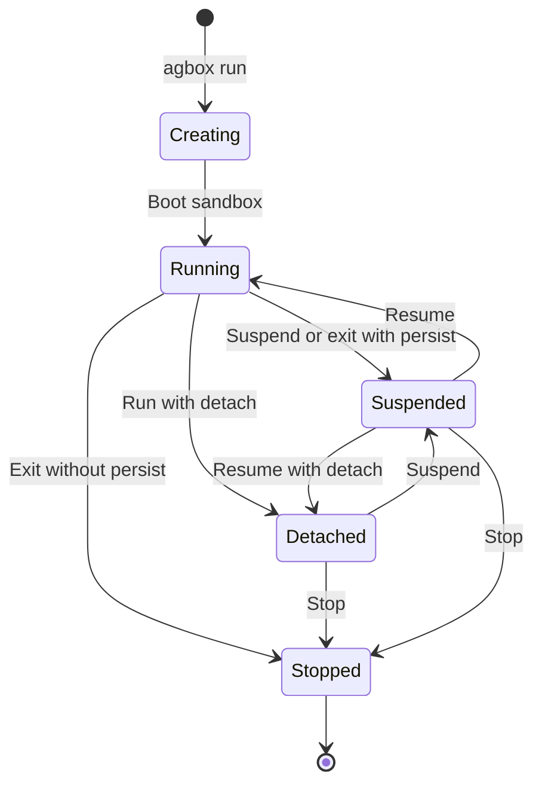

# agbox User Guide

This guide describes each `agbox` workflow in order. It covers installation, base setup, daily runs, share controls, conversation persistence, agent updates, and removal. A sandbox is one microVM that `agbox` starts for a run.

For architecture and security properties, see [README.md](README.md).

## 1. Install and check the host

Run the installer from the repository root as your normal user:

```bash
./install.sh
```

To install as `root`, pass `--allow-root` or set `AGBOX_ALLOW_ROOT=1`:

```bash
./install.sh --allow-root
```

The installer runs these steps:

1. It rejects `root` unless you pass `--allow-root` or set `AGBOX_ALLOW_ROOT=1`.
1. It warns when the host is not Debian or Ubuntu.
1. It checks that `glibc` is version 2.28 or newer.
1. It requires the `go` toolchain and `fusermount3` (or `fusermount`).
1. It downloads the `msb` installer to a temporary file over HTTPS (TLS 1.2 or newer) when `msb` is missing. Then it runs that file.
1. It builds a static `agbox` binary and installs it atomically. The default directory is `~/.local/bin` (`/usr/local/bin` for `root`, or `$AGBOX_INSTALL_DIR`).
1. It refuses to replace a symlink or a directory at the target path.
1. It installs `AGBOX_ENV_RULES.md` into `$DATA_DIR/rules`.
1. It installs the bash completion script unless you pass `--skip-completion`. The default directory is `${XDG_DATA_HOME:-~/.local/share}/bash-completion/completions` (`/usr/share/bash-completion/completions` for `root`, or `$AGBOX_COMPLETION_DIR`).
1. It runs `agbox setup` unless you pass `--skip-setup`.
1. It warns when the install directory is not on `PATH`.

> [!TIP]
> Pass `--skip-setup` on hosts without `/dev/kvm`, such as headless containers. To load bash completion directly in `~/.bashrc`, add `eval "$(agbox completion bash)"`.

To check the host again at any time, run these commands:

```bash
agbox setup
agbox status
```

## 2. Create the base snapshot

Create a base snapshot with `opencode`, `antigravity` (`agy`), or `both`. Pass `--add` (alias `--categories`) to include developer toolchains. The category `all` installs every category.

```bash
agbox create-base --add core,go,rust,esphome both
```

Every snapshot includes `shellcheck`, `mdformat` (with `mdformat-gfm`), and standard CLI tools. It also sets `PYTHONDONTWRITEBYTECODE=1` in the guest environment. `create-base` also writes default agent settings for unattended work. It writes a settings file only when that file does not exist:

- **Antigravity (`agy`):** `toolPermission` is `"always-proceed"` (`turbo`). `queuedMessages` is `"send-immediately"`. `allowNonWorkspaceAccess` is `true`. `trustedWorkspaces` is `["/workspace"]`. The file is `/home/agent/.gemini/antigravity-cli/settings.json`.
- **OpenCode (`opencode`):** `"permission"` is `"allow"` in `/home/agent/.config/opencode/opencode.json`. Queued follow-up messages already steer an active turn by default.

When `create-base` ends, `agbox` stops `agbox-base` and saves the snapshot `agbox:v1`.

### Categories

Run `agbox edit-base --list` to print the categories. You can also read the table:

<details>
<summary>Categories and package details</summary>

| Category | Aliases | Installed packages and tools |
|---|---|---|
| `core` | `base`, `cli` | `build-essential`, `pkg-config`, `cmake`, `ninja-build`, `ccache`, `fuse3`, `libffi-dev`, `libssl-dev`, `libsqlite3-dev`, `sqlite3`, `ca-certificates`, `curl`, `wget`, `git`, `htop`, `ncdu`, `net-tools`, `iproute2`, `dnsutils`, `rsync`, `unzip`, `zip`, `vim`, `jq`, `ripgrep`, `fd-find`, `shellcheck`, `less`, `procps`, `psmisc`, `lsof`, `strace`, `tree`, `file`, `openssh-client`, `poppler-utils`, `qpdf`, `python3-pypdf`, `python3`, `python3-pip`, `python3-setuptools`, `python3-venv`, `python3-wheel`, `pipx`, `uv` (`/usr/local/bin/uv`), and `mdformat` with `mdformat-gfm` (through `pipx`). Sets `CMAKE_C_COMPILER_LAUNCHER` and `CMAKE_CXX_COMPILER_LAUNCHER` to `/usr/bin/ccache`. |
| `go` | `golang` | The upstream Go toolchain in `/usr/local/go` (fallback: `golang-go`), `protobuf-compiler`, and `dlv`, `gopls`, `golangci-lint`, `goimports`, `staticcheck`, `govulncheck`, `protoc-gen-go`, and `protoc-gen-go-grpc` in `/home/agent/go/bin`. |
| `rust` | `cargo`, `rustup` | The `rustup` stable toolchain with `clippy`, `rustfmt`, `rust-analyzer`, and `rust-src`. Also `clang`, `lld`, `pkg-config`, `libssl-dev`, `libudev-dev`, `libusb-1.0-0-dev`, `protobuf-compiler`, and `sccache`. |
| `esphome` | `esp` | `esphome` (with `pio`, `platformio`, and `piodebuggdb` symlinked from its venv) and `esptool` through `pipx`. Also `libudev-dev`, `libusb-1.0-0-dev`, `udev`, `usbutils`, `cmake`, `ninja-build`, `gperf`, `ccache`, `dfu-util`, `picocom`, and `minicom`. Pre-warms `~/.platformio` and `~/.platformio/penv` for ESP32 and ESP32-S3 (`esp-idf` and `arduino`), applies `ccache` patches to `espressif32` builder scripts, adds PlatformIO toolchains to `PATH`, and sets `ESPHOME_DATA_DIR`, `ESPHOME_NOGITIGNORE`, and `CMAKE_*_COMPILER_LAUNCHER`. |
| `embedded-rust` | `esp-rust` | The `riscv32imc-unknown-none-elf` and `riscv32imac-unknown-none-elf` Rust targets. Also `espflash`, `cargo-espflash`, and `ldproxy`. Includes `rust`. |
| `chrome` | `browser`, `chromium`, `devtools` | `chromium`, `chromium-driver`, `xvfb`, `fonts-liberation`, `fonts-noto-color-emoji`, `libnss3`, `libatk-bridge2.0-0`, `libdrm2`, `libxkbcommon0`, and `libgbm1`. Sets headless flags (`--no-sandbox --disable-dev-shm-usage`) and `google-chrome` and `chrome` symlinks. |
| `hugo` | `static-site` | The Hugo Extended binary (`/usr/local/bin/hugo`) with Sass and SCSS support. |
| `caddy` | `xcaddy` | A custom `caddy` binary that `xcaddy` builds with `github.com/caddy-dns/cloudflare`, `github.com/greenpau/caddy-security`, and `github.com/mholt/caddy-l4`. Includes `go`. |

</details>

## 3. Authenticate agents

Save login credentials with `agbox auth`, or export API keys in your host shell.

### Saved credentials (`agbox auth`)

`agbox auth` signs in Google Antigravity (`agy`) or OpenCode OAuth providers. It never bakes credentials into a snapshot. It never shares host credential directories.

```bash
# Sign in to Antigravity inside a zero-share sandbox
agbox auth antigravity

# Sign in to OpenCode providers inside a zero-share sandbox
agbox auth opencode

# Show saved credential status
agbox auth status

# Delete saved credentials
agbox auth logout all
```

`agbox auth` runs these steps:

1. It boots a disposable `agbox-auth-<pid>` sandbox with zero host shares.
1. It runs the interactive login (`agy` or `opencode auth login`) as user `agent`.
1. It captures only allowlisted files, each under 64 KiB. The files are `antigravity-oauth-token`, `installation_id`, `antigravity_state.pbtxt`, `jetski_state.pbtxt`, and `auth.json`.
1. It saves them in `$DATA_DIR/auth/<agent>` (mode `0600`).
1. It deletes `agbox-auth-<pid>` on exit.

On each `agbox run` and `agbox resume`, `agbox` streams saved credentials over `stdin` into the sandbox (mode `0600`). Pass `--no-auth` to skip them for one run or resume.

> [!NOTE]
> You can also sign in inside `agbox run`. When a disposable run ends, `agbox` deletes the sandbox and the session token.

### Per-run API keys

Export your provider API keys in the host shell before `agbox run`:

```bash
export ANTHROPIC_API_KEY="sk-ant-..."
export GEMINI_API_KEY="AIza..."
export OPENAI_API_KEY="sk-..."

agbox run opencode ~/projects/myapp
```

`agbox` streams non-empty keys over `stdin` into `/home/agent/.agbox-keys.sh` (mode `0600`). It never puts secrets in CLI arguments. If key streaming fails, `agbox` stops.

<details>
<summary>Passthrough variables</summary>

- **Model providers:** `ANTHROPIC_API_KEY`, `OPENAI_API_KEY`, `GEMINI_API_KEY`, `GOOGLE_API_KEY`, `GOOGLE_GENERATIVE_AI_API_KEY`, `GROQ_API_KEY`, `OPENROUTER_API_KEY`, `MISTRAL_API_KEY`, `DEEPSEEK_API_KEY`, `COHERE_API_KEY`, `PERPLEXITY_API_KEY`, `TOGETHER_API_KEY`, `FIREWORKS_API_KEY`, `CEREBRAS_API_KEY`, `XAI_API_KEY`, `OLLAMA_HOST`
- **Cloud providers:** `AWS_ACCESS_KEY_ID`, `AWS_SECRET_ACCESS_KEY`, `AWS_SESSION_TOKEN`, `AWS_REGION`, `AWS_PROFILE`, `VERTEX_LOCATION`, `GOOGLE_CLOUD_PROJECT`, `GOOGLE_CLOUD_LOCATION`, `AZURE_OPENAI_API_KEY`, `AZURE_OPENAI_ENDPOINT`
- **GitHub and web UI:** `GITHUB_TOKEN`, `GH_TOKEN`, `OPENCODE_SERVER_PASSWORD`, `OPENCODE_SERVER_USERNAME`
- **Terminal:** `COLORTERM`

</details>

## 4. Add global skills and rules

Global skills and rules mount read-only and apply to all projects. Shared directories can also hold project-local skills and instructions.

### Global skills (`agbox skills`)

Store reusable skills in `$DATA_DIR/skills` on the host:

```bash
# Install a skill directory (or a SKILL.md path) into $DATA_DIR/skills/<name>
agbox skills add ~/my-skills/code-review

# Replace an existing global skill
agbox skills add --force ~/my-skills/code-review

# List or delete global skills
agbox skills list
agbox skills rm code-review
```

When `$DATA_DIR/skills` holds a skill, `agbox run` mounts it read-only at `/home/agent/.agbox-skills`. Then it bind-mounts it read-only onto `/home/agent/.gemini/config/skills` and `/home/agent/.config/opencode/skills`. Guest processes, including guest `root`, cannot change the host files. Pass `--no-skills` to skip global skills for one run or resume.

### Global rules (`agbox rules`)

Store standing Markdown instructions in `$DATA_DIR/rules` on the host:

```bash
# Install a Markdown rule file into $DATA_DIR/rules/<name>.md
agbox rules add ~/my-rules/engineering-standards.md

# Save or replace a rule under a custom name
agbox rules add --force --name standards ~/my-rules/engineering-standards.md

# List or print rules
agbox rules list
agbox rules show standards

# Delete one rule or all rules
agbox rules rm standards
agbox rules rm --all
```

`./install.sh` and `agbox setup` install `AGBOX_ENV_RULES.md` into `$DATA_DIR/rules`. This default rule teaches the agent about guest privileges, VCS masking, the `/workspace` layout, and network limits. To delete it, run `agbox rules rm AGBOX_ENV_RULES`. Pass `--no-rules` to skip rules for one run or resume.

When `$DATA_DIR/rules` holds `.md` files (64 KiB maximum each), `agbox run` mounts it read-only at `/home/agent/.agbox-rules`. On each `agbox run` and `agbox resume`, `agbox` stages the rules and bind-mounts them read-only:

- Plain Markdown files and `trigger: always_on` files merge in a fixed order. `AGENTS.md` and `GEMINI.md` come first. Then `*.md` files follow in alphabetical order. The result is `/etc/agbox-global-rules/AGENTS.md` (mode `0444`).
- `agbox` bind-mounts that file read-only onto `/home/agent/.gemini/config/AGENTS.md` and `/home/agent/.config/opencode/AGENTS.md`. Both `agy` and `opencode` read it.
- Antigravity rule files with YAML frontmatter (`trigger: glob`, `model_decision`, or `manual`) go to `/etc/agbox-global-rules/rules/*.md` (mode `0444`). `agbox` bind-mounts that directory read-only onto `/home/agent/.gemini/config/rules`.
- Host edits to `$DATA_DIR/rules` apply on the next `agbox run` or `agbox resume`. You do not rebuild `agbox:vN`.

### Project skills and instructions

When you share one project directory, `agbox` starts the agent in `/workspace/<name>`. Both agents find these files through the VCS filter while `.git` and `.jj` stay masked:

- `AGENTS.md` and `GEMINI.md`
- `.agents/rules/*.md`
- `.agents/skills/<skill>/SKILL.md`
- `.opencode/skills/<skill>/SKILL.md`

When you share several directories with `antigravity`, `agbox` passes `--add-dir /workspace/<name>` for each directory.

## 5. Run agents and share project directories

`agbox` mounts no host directory unless you pass a path or `--share-hub`.

> [!IMPORTANT]
> Place all options before the agent name and the shared paths.

### Run sessions and one-shot commands

```bash
# Run interactive OpenCode in a disposable sandbox
agbox run opencode ~/projects/myapp

# Run Antigravity in a named sandbox (agbox-myapp)
agbox run --name myapp antigravity ~/projects/myapp

# Run one shell command in a disposable sandbox
agbox run --cmd "go test ./..." ~/projects/myapp

# Run with no guest network and custom vCPU and RAM
agbox run --no-net --cpus 2 --memory 4G --cmd "cargo test" ~/projects/crate
```

With `--name <name>`, `agbox` names the sandbox `agbox-<name>` instead of `agbox-run-<pid>`. A name has 1 to 63 ASCII letters, digits, `-`, or `_`. It starts with a letter or digit. `agbox` reserves the names `base` and `run-<digits>`.

If `agbox-<name>` exists, `agbox run` fails and leaves it unchanged. One exception applies. With `--persist`, `agbox run` resumes a suspended `agbox-<name>`.

### Network profiles

Pass `--net <spec>` (alias `--net-rule`) to change network access for one run:

| Value | Effect |
|---|---|
| `public` | Default. Permits public internet only. |
| `none` or `--no-net` | Disables all guest networking. |
| `host` | Permits public internet and host services. |
| `private` | Permits public and private networks. |
| `allow@api.anthropic.com:tcp:443` | Permits only the listed endpoint. Accepts comma-separated rules. |
| `all` | Permits all outbound traffic. |

Every profile except `all` keeps the deny rules for loopback, link-local, multicast, and cloud metadata ranges. The `private` profile permits private ranges. The `host` profile permits the host.

> [!WARNING]
> `--net all` disables the network protections. Use it only for trusted code.

### Mix permissions across project directories

Pass modifiers as `<path>[:opts]` arguments or with repeatable `--share <path[:opts]>` flags:

```bash
# Docs read-only, shared library writable with VCS masked, main repo writable with VCS
agbox run antigravity \
  ~/projects/docs:ro \
  ~/projects/shared-lib:rw,mask \
  ~/projects/main-app:rw,vcs,as=app
```

| Modifier | Effect |
|---|---|
| `ro` | Read-only. Writes fail with `EROFS`. Write permission bits are hidden. |
| `rw` | Read-write. This is the default for `agbox run` unless you pass `--ro`. |
| `mask` | Hides and write-protects 22 VCS names. This is the default. Alias: `mask-vcs`. |
| `vcs` | Allows VCS tools (`git`, `jj`, `hg`, `svn`, `bzr`, `sl`). Write-protects hooks, executable config files, and admin entries. |
| `vcs-hooks` | Like `vcs`, with writable hooks. Needs a writable share. |
| `as=<name>` | Mounts the share at `/workspace/<name>`. Uses up to 128 characters. Rejects `.`, `..`, `:`, `,`, `/`, `\`, whitespace, control characters, and VCS names. |

`agbox` rejects conflicting options. Examples are `--ro` with `--rw`, `:ro,rw` on one share, `:ro` with `:vcs-hooks`, and `:vcs` on a single-file share.

> [!WARNING]
> `--no-mask` turns off the FUSE VCS filter. The guest then sees `.git` and its hooks. Use it only for trusted agents.

### Add, change, or delete shares live (`agbox share`)

A sandbox with shares mounts a multiplexed `/workspace` Workspace Hub. A host-only Unix socket controls the hub: `$DATA_DIR/run/<id>/ws.sock` (mode `0600`). The socket checks the peer UID with `SO_PEERCRED`. You can manage shares while the sandbox runs or while it is in the suspended state:

```bash
# Start a sandbox with an empty hub
agbox run --name work --share-hub opencode

# Attach a share from another terminal (read-only, VCS masked)
agbox share add agbox-work ~/projects/docs

# Attach a writable VCS share under a custom name
agbox share add --rw --vcs --as app agbox-work ~/projects/main-app

# List shares and open file-handle counts
agbox share list agbox-work

# Make a share read-only and mask its VCS metadata
agbox share set --ro --mask-vcs agbox-work app

# Detach a share
agbox share rm agbox-work docs
```

Rules for `agbox share`:

- `agbox share add` creates a read-only share with masked VCS unless you pass `--rw` (or `:rw`). The `--vcs` flag changes only the VCS policy.
- `agbox share rm` and `agbox share set --ro` fail when the guest holds open writable descriptors.
- `agbox share set --mask-vcs` revokes open descriptors to VCS control files and hides them from listings.
- Live changes persist in `$DATA_DIR/run/<id>/run.meta` across `suspend` and `resume`. They also flush the guest VFS lookup caches.

> [!WARNING]
> Pass `--force` to revoke open handles at once. Open handles then fail with `ESTALE` after a detach and with `EROFS` after a downgrade.

## 6. Persist conversations and manage sandboxes

By default, `agbox run` is disposable. It deletes conversation history on exit. Use `--persist`, `--profile`, or `agbox suspend` for longer work.



### Named persistent sandbox (`--persist`)

Use `--persist --name <name>` to keep the root disk across runs:

```bash
# The first run creates agbox-myapp and suspends it on exit
agbox run --persist --name myapp opencode ~/projects/myapp

# The next run resumes agbox-myapp and continues the latest conversation
agbox run --persist --name myapp -c opencode ~/projects/myapp

# Delete the sandbox when you finish
agbox stop agbox-myapp
```

`--persist` keeps conversation databases, artifacts, `apt` packages, and build caches in `agbox-<name>`. A stopped `agbox-<name>` uses no host CPU, RAM, or FUSE processes.

### Conversation profile (`--profile`)

Use `--profile <name>` to keep conversations on a dedicated `ext4` disk (`agbox-profile-<name>`). Each run still boots a fresh root filesystem from `agbox:vN`:

```bash
# Optional: create a profile with a custom disk size (default: 10G)
agbox profile create --size 20G work

# Run a disposable sandbox on profile "work"
agbox run --profile work antigravity ~/projects/myapp

# Continue the latest conversation or a specific one
agbox run --profile work -c antigravity ~/projects/myapp
agbox run --profile work --conversation 1c2a8c1e-6b56-4971-8429-ad0252c024a7 antigravity ~/projects/myapp

# List or delete profiles
agbox profile list
agbox profile rm work
```

A profile name has 48 characters or fewer. `--profile` bind-mounts these guest directories from the profile disk:

- `~/.gemini/antigravity-cli`
- `~/.gemini/config/projects`
- `~/.local/share/opencode`
- `~/.local/state/opencode`

Before it mounts `~/.gemini/antigravity-cli`, `agbox` copies `bin`, `builtin`, `updater`, and `settings.json` from the snapshot onto the profile disk. Global skills, rules, and system binaries stay on the snapshot root disk.

A host `flock` on `$DATA_DIR/profiles/.<name>.lock` stops two sandboxes from mounting one profile at the same time.

`agbox resume` also accepts `-c` (`--continue`) and `-s <ID>` (`--session <ID>` or `--conversation <ID>`).

### Suspend, resume, and delete

Suspend a sandbox to free host CPU, RAM, and FUSE processes. The root disk stays.

```bash
agbox suspend agbox-feature-auth
```

`agbox suspend` runs these steps:

1. It writes `$DATA_DIR/run/<id>/suspended` with the share paths and run mode.
1. It runs `msb stop <sandbox>`. This stops the guest kernel and keeps the root disk.
1. It unmounts all host FUSE filters. Zero background processes remain.

If you suspend from a second terminal, the foreground `agbox` process exits and skips `msb rm -f`.

> [!NOTE]
> `msb stop` stops the guest kernel. It does not freeze guest RAM. Files on the root disk persist. `agbox resume` starts a new agent process.

Resume a suspended sandbox to continue:

```bash
agbox resume agbox-feature-auth
```

`agbox resume` runs these steps:

1. It checks every recorded share path again with `pathsec.ValidateShare`.
1. It mounts the Workspace Hub (or the older `m*` filters) at the recorded `$DATA_DIR/run/<id>` path.
1. It runs `msb start <sandbox>` and streams current API keys and saved credentials over `stdin`.
1. It starts the recorded agent, `--serve` server, `--remote-control` daemon, or command.

Pass `-d` to detach a `--serve` or `--remote-control` sandbox on resume. If a share check, a FUSE mount, or `msb start` fails, `agbox resume` stops. The sandbox stays suspended.

Delete a running or suspended sandbox and its `$DATA_DIR/run/<id>` state:

```bash
agbox stop agbox-feature-auth
```

Run `agbox status` to list sandboxes, snapshots, skills, rules, and profiles.

## 7. Connect by web interface or Remote Control

Instead of a terminal UI, you can serve OpenCode over local HTTP (`--serve`). You can also tunnel Antigravity to `antigravity.google.com` (`--remote-control`). Both modes accept `-d` (`--detach`) and `--persist`.

### OpenCode web interface (`--serve`)

`agbox` runs `opencode serve` in the sandbox. It binds the host port to `127.0.0.1` only.

```bash
# Start on a random free loopback port. agbox waits for /doc and prints the URL.
agbox run --serve ~/projects/myapp

# Start on the fixed host port 127.0.0.1:4096
agbox run --name web --serve --port 4096 ~/projects/myapp
```

Local host processes can connect to `127.0.0.1:<port>`. To require HTTP Basic Authentication, set `OPENCODE_SERVER_PASSWORD`. You can also set `OPENCODE_SERVER_USERNAME` (default: `opencode`):

```bash
export OPENCODE_SERVER_USERNAME="admin"
export OPENCODE_SERVER_PASSWORD="choose-a-strong-password"

# Start detached in the background
agbox run --name web -d --serve --port 4096 ~/projects/myapp
```

Suspend with `agbox suspend agbox-web`. Resume with `agbox resume -d agbox-web`. Delete with `agbox stop agbox-web`.

### Antigravity Remote Control (`--remote-control`)

Remote Control connects an `agy` session in the sandbox to `https://antigravity.google.com`. `agy` opens an outbound reverse tunnel over the default `public` profile. You need no `--port` and no inbound firewall rule.

1. Start a named detached sandbox. Add `--persist` to keep its disk after a stop:
   ```bash
   agbox run --persist --name work -d --remote-control ~/projects/myapp
   ```
1. If `agy` needs a login and you did not run `agbox auth antigravity`, `agbox` opens `agy` interactively. Open the printed URL, paste the code, and run `/exit`.
1. `agbox` starts `agy remote-control start --name agbox-work` in the sandbox. Then it returns your shell prompt.
1. Open `https://antigravity.google.com`. Select `agbox-work` in the instance switcher.
1. Suspend with `agbox suspend agbox-work`. Delete with `agbox stop agbox-work`.

Pass `--remote-control` without `-d` to keep the terminal UI open:

```bash
agbox run --remote-control ~/projects/myapp
```

Inside any interactive `agy` session, `/remote-control` and `/remote-control off` toggle Remote Control.

### Auto-start with `systemd --user` (`agbox service`)

Use `agbox service` to run headless sandboxes at machine boot without login and keep them running after logout. `agbox` installs one shared user template unit (`~/.config/systemd/user/agbox@.service`) and stores each service spec in `$DATA_DIR/services/<name>.json` (mode `0600`).

Each service runs under a foreground supervisor (`agbox __service-run <name>`). The template unit sets `Type=notify`, `WatchdogSec=90s`, `KillMode=mixed`, and `TimeoutStopSec=30`. The supervisor sends `READY=1` once the agent answers health checks, sends `WATCHDOG=1` on each healthy poll, and exits non-zero after 3 consecutive failed checks so `systemd` restarts the service (`opencode serve` probes `http://127.0.0.1:<port>/doc`, and `agy` runs `msb ping` plus `agy remote-control status`). On stop or host reboot, the supervisor stops the microVM first, flushes any `--persist` or `--profile` disk, and then unmounts FUSE shares.

```bash
# Save a persistent Remote Control service and enable it at boot
agbox service add work --persist --remote-control ~/projects/myapp
agbox service enable --now work

# Save an OpenCode web UI service with a mode 0600 secret env file
chmod 600 ~/.config/agbox-web.env
agbox service add --env-file ~/.config/agbox-web.env web --profile dev --serve --port 4096 ~/projects/myapp
agbox service enable --now web

# Inspect services, user linger state, and journal logs
agbox service list
agbox service logs -f work
agbox service linger status

# Stop, disable, or delete a service
agbox service disable --now work
agbox service rm work
```

Rules for `agbox service`:

- Services require a headless mode: `--remote-control`, `--serve --port N`, or `--cmd "shell"`. Interactive TUI runs are rejected.
- `agbox service enable` activates `systemd-logind` user linger (`loginctl enable-linger <user>`) unless you pass `--no-linger`. If polkit blocks unprivileged linger, run `sudo loginctl enable-linger <user>` once so services start at boot without login and survive logout.
- Saved `agbox auth` credentials stream automatically at boot. Optional `--env-file` paths must be regular files with mode `0600` or stricter and zero symlinks. `agbox` never writes secrets into `agbox@.service`.
- On startup after an unclean host reboot, the supervisor recovers stopped `--persist` sandboxes and cleans stale ephemeral sandboxes before starting.

## 8. Update agents and customize the base image

Use `agbox update` to refresh `agy` and `opencode` quickly. Use `agbox edit-base` to add categories or packages to the base snapshot.

### Update agent binaries (`agbox update`)

`agbox update` caches newer `agy` or `opencode` releases in `$DATA_DIR/agents`. You do not rebuild `agbox:vN`.

```bash
# Update all agents in the base image
agbox update

# Update one agent
agbox update antigravity
agbox update opencode

# Show cached versions and SHA-256 digests
agbox update status

# Revert to the binaries in the base snapshot
agbox update clear
```

`agbox update` runs these steps:

1. It boots a disposable `agbox-update-<pid>` sandbox with zero host shares, zero API keys, and zero saved credentials.
1. It runs the upstream HTTPS (TLS 1.2 or newer) installer in that sandbox and checks `--version`.
1. It streams the new binary to the host. It checks the ELF header (`\x7fELF`), the size bounds, and `st_nlink == 1`.
1. It records SHA-256 digests in `manifest.json` and seals the binary at mode `0755` in `$DATA_DIR/agents/bin`.
1. On later runs, it mounts `$DATA_DIR/agents` read-only at `/home/agent/.agbox-agents`. It bind-mounts the verified binaries read-only over the guest binary paths.

Pass `--no-agent-cache` to `agbox run` or `agbox resume` to skip the cache for one session.

### Change the base image (`agbox edit-base`)

`edit-base` changes the base sandbox and saves a new snapshot (`agbox:v<N+1>`):

```bash
# Open the interactive category selector
agbox edit-base

# List categories and packages
agbox edit-base --list

# Install categories and save a new snapshot
agbox edit-base --add chrome,hugo,caddy

# Run a command, or open a root shell, in the base sandbox
agbox edit-base --cmd "apt-get update && apt-get install -y jq"
agbox edit-base --shell
```

Pass `--no-snap` to keep edits in `agbox-base` without a new snapshot.

## 9. CLI reference, environment variables, and deletion

### Commands

Run `agbox <mode> --help` for the flags of each mode. Run `agbox --help` for the full list.

| Command | Purpose |
|---|---|
| `agbox setup` | Checks `msb`, `/dev/kvm`, FUSE, and runs a sandbox smoke test. |
| `agbox version` | Prints the version. `agbox --version` does the same. |
| `agbox completion bash` | Prints the bash completion script to `stdout`. |
| `agbox create-base [--force] [--add <categories>] <opencode\|antigravity\|both>` | Creates the base sandbox and saves `agbox:vN`. |
| `agbox edit-base [--add <categories>] [--list] [--shell] [--cmd "shell"] [--no-snap]` | Changes the base sandbox. Saves `agbox:v<N+1>` unless you pass `--no-snap`. |
| `agbox update [antigravity\|opencode\|both\|status\|clear]` | Caches checked agent binaries in `$DATA_DIR/agents`. |
| `agbox auth [antigravity\|opencode\|status\|logout]` | Signs in inside a disposable sandbox and saves credentials. |
| `agbox skills [list\|add [--force] <path>\|rm <name>]` | Manages global skills. |
| `agbox rules [list\|add [--force] [--name NAME] <file.md>\|show [<name>]\|rm <name\|--all>]` | Manages global rules. |
| `agbox profile [list\|create [--size SIZE] <name>\|rm [--force] <name>]` | Manages `ext4` conversation profiles. |
| `agbox share <list\|add\|set\|rm> <sandbox> [...]` | Manages `/workspace` shares on a running or suspended sandbox. |
| `agbox service <list\|add\|enable\|disable\|start\|stop\|restart\|logs\|rm\|linger> [...]` | Manages `systemd --user` services (`agbox@.service`) that start at boot and survive logout. |
| `agbox run [options] [opencode\|antigravity] [path[:opts]...]` | Restores a sandbox and runs an agent or command. |
| `agbox suspend <sandbox>` | Stops a sandbox, keeps its root disk, and unmounts its shares. |
| `agbox resume [-d] [-c] [-s ID] [--no-auth] [--no-skills] [--no-rules] [--no-agent-cache] <sandbox>` | Checks shares, mounts FUSE, starts the sandbox, and restarts its agent. |
| `agbox stop <sandbox>` | Deletes a running or suspended sandbox and unmounts its shares. |
| `agbox remove [-y]` | Deletes all `agbox` state. See [Delete all state](#delete-all-state-agbox-remove). |
| `agbox status` | Shows base settings, persistence state, sandboxes, snapshots, and disk use. |

Every mode accepts `--allow-root` (or `AGBOX_ALLOW_ROOT=1`) for host `root`.

### `agbox run` options

Place all options before the agent name and the paths.

| Option | Effect |
|---|---|
| `--name NAME` | Names the sandbox `agbox-NAME` instead of `agbox-run-<pid>`. |
| `--persist` | Keeps the named sandbox on exit and resumes it on a repeat run. |
| `--profile NAME` | Mounts the `ext4` profile `agbox-profile-NAME` for conversations. |
| `-c`, `--continue` | Continues the latest conversation in terminal mode. |
| `-s ID`, `--session ID` | Continues conversation `ID`. Alias: `--conversation`. |
| `--no-auth` | Skips saved credentials from `$DATA_DIR/auth`. |
| `--no-skills` | Skips global skills from `$DATA_DIR/skills`. |
| `--no-rules` | Skips global rules from `$DATA_DIR/rules`. |
| `--no-agent-cache` | Skips cached agent binaries from `$DATA_DIR/agents`. |
| `--share PATH[:OPTS]` | Shares a host path. Modifiers: `ro`, `rw`, `mask`, `vcs`, `vcs-hooks`, `as=NAME`. |
| `--share-hub` | Mounts an empty `/workspace` hub for live shares. |
| `--ro`, `--rw` | Sets the default share access. Rejects a conflicting modifier. |
| `--mask-vcs` | Masks VCS metadata in directory shares. This is the default. |
| `--vcs` | Allows VCS metadata and write-protects hooks. |
| `--vcs-hooks` | Allows VCS metadata and writable hooks on writable shares. |
| `--no-mask` | Turns off the FUSE VCS filter and exposes `.git` to the guest. |
| `--serve` | Runs `opencode serve` and binds the web UI to `127.0.0.1`. |
| `--port N` | Uses the fixed loopback port `N` for `--serve`. The default is random. |
| `--probe` | With `--serve`: waits for the web UI, then exits. |
| `--remote-control` | Runs `agy` with Remote Control for `antigravity.google.com`. |
| `-d`, `--detach` | Keeps `--serve` or `--remote-control` running in the background. |
| `--cmd "shell"` | Runs one command in the sandbox and exits. |
| `--no-net` | Disables guest networking. |
| `--net SPEC` | Sets the network profile or rule. See [Network profiles](#network-profiles). |
| `--cpus N`, `--memory SIZE` | Overrides the vCPU count or RAM size for this run. |

Options also accept the `--name=NAME` form. A `--` argument ends option parsing.

> [!NOTE]
> The agent is `opencode` or `antigravity`. The default is the agent in the base snapshot.

### Environment variables

| Variable | Default | Purpose |
|---|---|---|
| `AGBOX_DATA_DIR` | `~/.local/share/agbox` | Host directory for `config`, `auth`, `agents`, `skills`, `rules`, `profiles`, and `run/<id>`. |
| `MSB_HOME` | `~/.microsandbox` | Host directory for `msb` runtime state, base snapshots, and profile volumes. |
| `AGBOX_INSTALL_DIR` | `~/.local/bin` (`/usr/local/bin` for `root`) | Directory where `install.sh` installs the binary. |
| `AGBOX_COMPLETION_DIR` | `~/.local/share/bash-completion/completions` (`/usr/share/bash-completion/completions` for `root`) | Directory where `install.sh` installs the bash completion script. |
| `AGBOX_ALLOW_ROOT` | `0` | Set to `1` to let `install.sh` and `agbox` run as `root`. |
| `AGBOX_CPUS` | `4` | Default vCPU count for `create-base` and `run`. |
| `AGBOX_MEMORY` | `8G` | Default guest RAM size for `create-base` and `run`. |
| `AGBOX_ROOT_DISK` | `50G` | Default sparse root disk size for `create-base` and `edit-base`. |
| `AGBOX_PROFILE_DISK` | `10G` | Default `ext4` disk size for `agbox profile create` and `run --profile`. |
| `AGBOX_MASK_VCS` | `strict` | VCS filter policy: `strict`, `auto`, or `off`. |
| `AGBOX_ALLOW_OUTSIDE_HOME` | `0` | Set to `1` to allow shares outside `$HOME`. The blocklists still apply. |
| `AGBOX_OPENCODE_VERSION` | `latest` | The npm version or tag of `opencode-ai` for `create-base` and `update`. |
| `AGBOX_AGY_INSTALLER_URL` | `https://antigravity.google/cli/install.sh` | The `agy` installer URL for `create-base` and `update`. It must use HTTPS. |
| `OPENCODE_SERVER_PASSWORD` | unset | HTTP Basic Auth password for `agbox run --serve`. |
| `OPENCODE_SERVER_USERNAME` | `opencode` | HTTP Basic Auth user name for `agbox run --serve`. |

The values `1`, `true`, and `yes` mean `strict` for `AGBOX_MASK_VCS`. The values `0`, `false`, and `no` mean `off`.

`strict` fails when the Workspace Hub cannot start. `DATA_DIR` must not contain whitespace or backslashes in that case.

> [!WARNING]
> `AGBOX_MASK_VCS=auto` mounts shares directly when the Workspace Hub cannot start. The mount has no VCS masking. `agbox` prints a warning. `off` always mounts directly.

> [!WARNING]
> `AGBOX_ALLOW_OUTSIDE_HOME=1` lets you share paths outside `$HOME`. Check each path before you share it.

### Delete all state (`agbox remove`)

> [!CAUTION]
> `agbox remove` deletes all `agbox` sandboxes, snapshots, profile volumes, FUSE mounts, and `$DATA_DIR`. You cannot undo it.

```bash
# Ask for confirmation first
agbox remove

# Skip the confirmation (for automation)
agbox remove --yes
```
